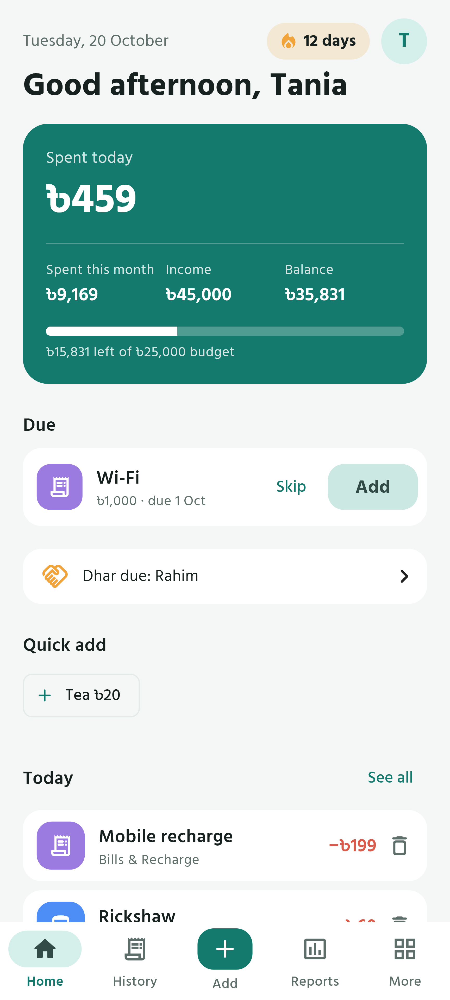
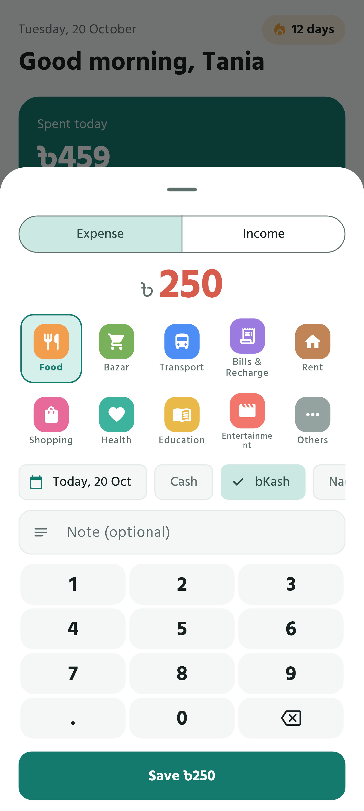
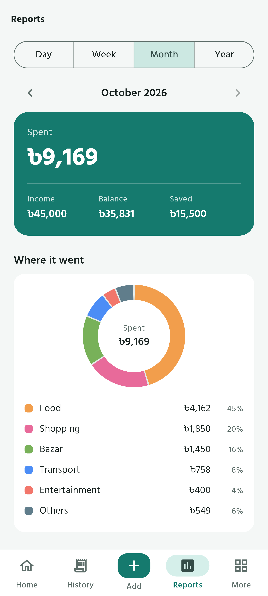
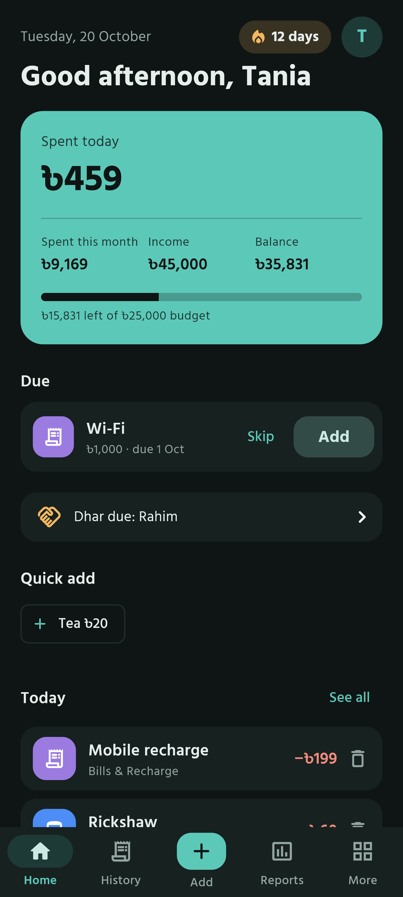
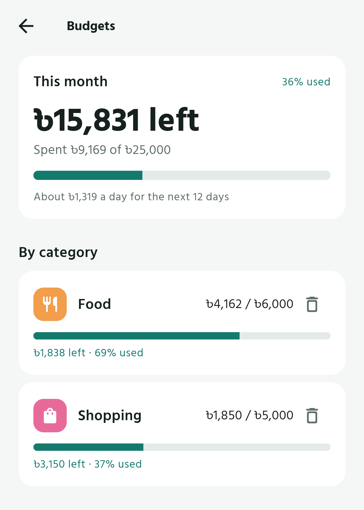
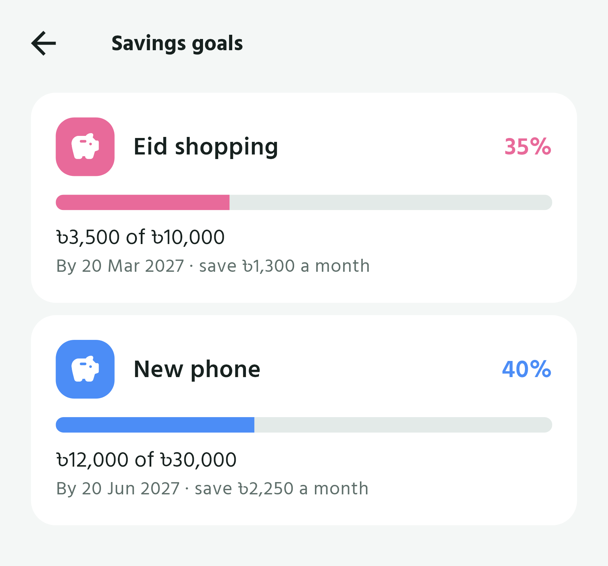
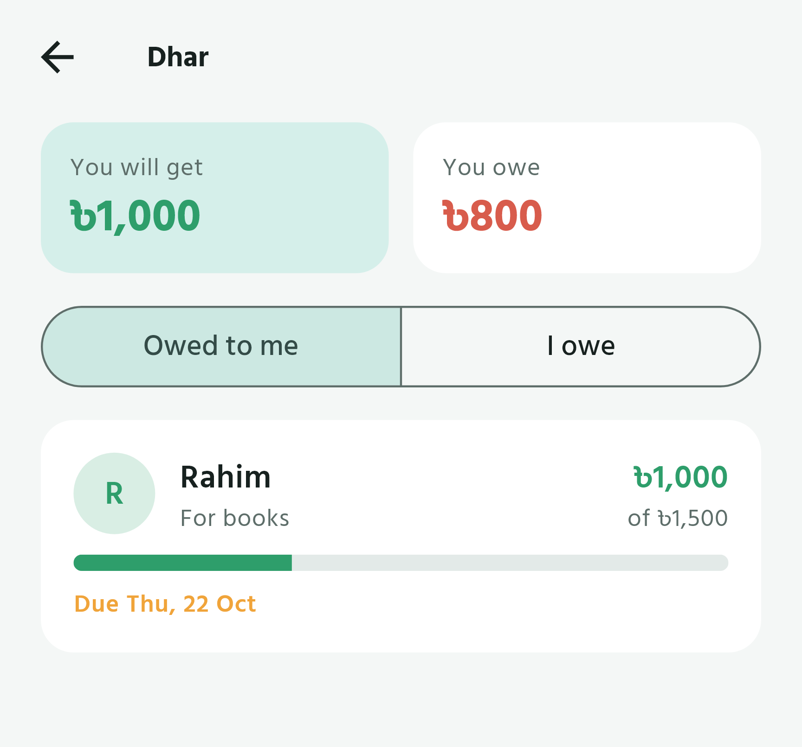

# Hisab

A calm, offline expense tracker for Bangladesh. Track expenses, income and savings in Taka (৳), get a reminder at 10 PM, and see where your money went by day, month and year.

**[Download the latest APK](https://github.com/jubayer2001/Hisab/releases/latest/download/Hisab.apk)** · [All releases](https://github.com/jubayer2001/Hisab/releases)

> **Version 1.0.** The first complete release: expenses, income, budgets, monthly bills and income, savings goals, dhar, reports, backup and an optional Google backup. See [what is new](https://github.com/jubayer2001/Hisab/releases/latest). Each release lists the SHA-256 of `Hisab.apk` so you can check your download.

## Install on your Android phone

1. Open the download link above in Chrome on your phone.
2. Open the downloaded `Hisab.apk`.
3. If asked, allow **Install unknown apps** for Chrome or your file manager.
4. If Play Protect says **"App blocked to protect your device"** or warns about an unknown developer, that is because Hisab is new and not (yet) on the Play Store. It is not a virus warning. Tap **More details → Install anyway**. If there is no such button, open the Play Store, tap your profile picture → **Play Protect** → the settings gear, turn off **Scan apps with Play Protect**, install Hisab, then turn it back on.

To update, download the new APK and install it over the old one. Your data stays.

**Xiaomi / Redmi / POCO:** to make sure the daily reminder arrives, open Settings → Apps → Hisab and turn on **Autostart**, set **Battery saver** to **No restrictions**, and allow **Notifications**. The app also explains this in **More → Reminder not arriving?**.

Works on Android 7.0 and newer.

## Screenshots

The pictures use made-up sample data.

| Home | Add an expense | Reports | Home, dark mode |
|:---:|:---:|:---:|:---:|
|  |  |  |  |

| Budgets | Savings goals | Dhar (lend and borrow) |
|:---:|:---:|:---:|
|  |  |  |

## Features

- **Add an expense in three taps:** amount, category, save. Repeat expenses (like tea) become one-tap chips.
- **Income and balance:** see what is left of your salary or tuition money.
- **Reports:** by day, week, month and year, with a category chart, daily bars and a comparison with the period before.
- **Budgets:** a monthly budget and per-category budgets, with a warning at 80% and again when you go over.
- **Recurring bills:** rent, Wi-Fi, recharge or salary. On the due day, confirm with one tap and change the amount if this month is different.
- **Savings goals:** save for something, with the monthly amount needed to reach it on time. Saved money is never counted as spending.
- **Dhar:** track money you lent or borrowed, with part payments and a reminder on the due date.
- **Reminders:** a nightly reminder to add the day's expenses, and a streak counter to build the habit.
- **Delete and erase:** a bin on every entry (with Undo), multi-select delete in History, and "Erase all data" with a 7-day undo.
- **Monthly income:** set your salary once and it records itself every month; other income is added any time.
- **Backup and restore:** save everything to one file and bring it back on any phone. Export to CSV for Excel or Google Sheets.
- **Optional Google backup:** sign in with Google and Hisab keeps a copy in a hidden folder of your own Google Drive, updated whenever you are online. Delete the app or change phones, sign in again, and everything comes back.
- **Light and dark mode.**
- **Private and secure:** no ads, no tracking, no analytics. The app works fully offline and your data always stays on your phone, **encrypted** with a key kept in Android's secure storage. Optional app lock (fingerprint, face, PIN or pattern), and the screens are hidden from screenshots and the recent-apps picture. Signing in with Google is optional; it is used only for the backup copy, in an app-only Drive folder (the `drive.appdata` permission, which cannot see any of your other files). Nothing is sent anywhere else. See the [privacy policy](docs/PRIVACY.md) and [SECURITY.md](SECURITY.md).

## Roadmap

Test versions go straight to the developer's phone over USB. Only 1.0 is published as a download here.

| Version | What it adds | Status |
|---|---|---|
| **v0.1** | The look and navigation only: Teal Mist theme, light and dark mode, bottom bar. | Done, published |
| **v0.2** | Add, edit and delete expenses and income. Categories, History with search, a real Home screen with today and this month, the 10 PM reminder and a battery-settings guide for Redmi and similar phones. The first version you can use every day. | Done, tested on a phone |
| **v0.3** | Reports by day, week, month and year, with charts. Balance (income minus spending). Monthly and per-category budgets with an 80% warning. | Done, tested on a phone |
| **v0.4** | Recurring bills, savings goals, the dhar (lend and borrow) tracker and the logging streak. | Done, tested on a phone |
| **v1.0** | First-run welcome (name, monthly budget, reminder time). Backup and restore, optional automatic backup to your Google account, CSV export, a proper app icon and splash screen, and screenshots here. Delete and erase, monthly income, encryption, app lock and a privacy page. | Released |

If a version has bugs, a small fix release (for example v0.2.1) comes before the next one. Changes requested after trying a version are made before building on top of it, so the list can grow a little.

## Development

Built with Flutter (stable 3.47), Riverpod, go_router, drift (SQLite) and Material 3. Amounts are stored as whole poisha, never as floating point numbers.

```bash
flutter pub get
flutter test
flutter run            # with a phone connected over USB
```

Helper scripts in `tool/`:

- `python tool/generate_icons.py` writes the launcher icon, themed icon and splash resources from `tool/reference/icon_final.png` (needs Pillow, OpenCV and numpy).
- `flutter test tool/screenshots_test.dart` then `python tool/clean_screenshots.py` remake the screenshots above from sample data.

Release builds shrink code with R8. Plugins that call Kotlin through JNI (like `shared_preferences`) need the keep rules in `android/app/proguard-rules.pro`. After changing plugins, test a **release** build on a phone, not only a debug run.

Releases are built by GitHub Actions when a tag like `v0.1.0` is pushed. Signing uses repository secrets `KEYSTORE_BASE64`, `KEYSTORE_PASSWORD`, `KEY_ALIAS` and `KEY_PASSWORD`.

Font: [Hind Siliguri](https://fonts.google.com/specimen/Hind+Siliguri), SIL Open Font License (see `assets/fonts/OFL.txt`).
